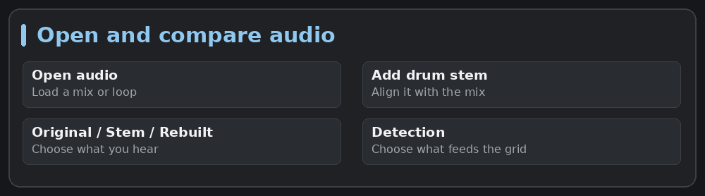
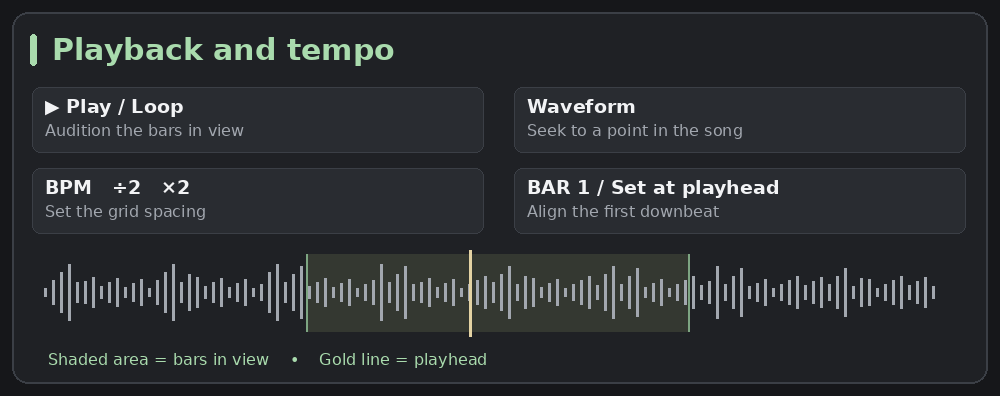
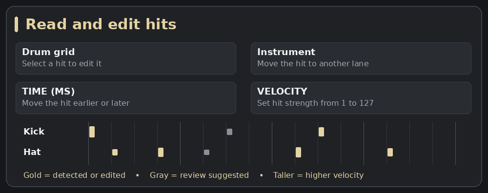
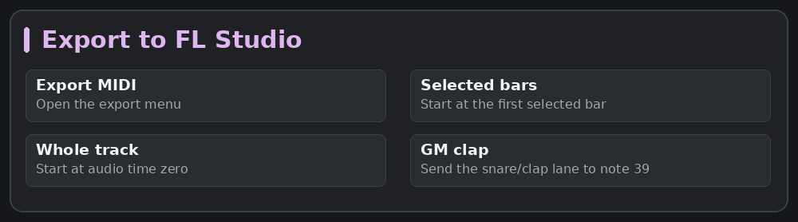

# Drumagon

**Turn a drum recording or full mix into an editable pattern and export it to FL Studio.**

Drumagon is an offline drum transcription prototype from Epsilon Sounds. It detects kicks, snares or claps, and hats. You can audition the reconstructed pattern, correct hits on the grid, and export MIDI with the timing and velocity intact.

1. On the repository page, choose **Code → Download ZIP**. Unzip it and open **Drumagon.html** in Chrome.
2. Press **Play** to hear the 140 BPM demo, or choose **Open audio** to load your own WAV or MP3.
3. Explore the controls below. The same guide is available under **Control guide** in the app.

## Open and compare audio



| Control | What it does |
| --- | --- |
| **Load demo** | Opens the built-in 140 BPM drill example and its matching drum stem. |
| **Open audio** | Loads a mix or loop for analysis. You can also drop an audio file onto the app. |
| **Add drum stem / Replace stem** | Loads an isolated drum track. Export it from the same starting point as the mix so the hits line up. |
| **Original / Stem / Rebuilt** | Hear the loaded mix, your supplied drum stem, or the current drum pattern played by Drumagon’s kit. |
| **Detection** | Full mix scans the original audio. Drum stem scans your isolated drums. Combined uses hits from both. This decides which hits appear in the grid. |

## Playback and tempo



| Control | What it does |
| --- | --- |
| **Play / Pause** | Plays or pauses the visible bar range. Space also toggles playback when you’re outside a control. |
| **Loop** | Repeats the selected bars until you pause or turn Loop off. |
| **Waveform and time display** | Click the waveform or use its slider to move the playhead. The clock shows the current time in the audio. |
| **BPM / ÷2 / ×2** | Sets the grid tempo. Use ÷2 or ×2 if a 140 BPM beat is read as 280 or 70. These controls change the grid spacing and export tempo. |
| **Bar 1 / Set at playhead** | Enter the first downbeat in seconds, or seek to it in the waveform and press Set at playhead to line up the bars. |

## Read and edit hits



| Control | What it does |
| --- | --- |
| **‹ / Bars in view / ›** | Go back or forward by the selected range. Choose 1, 2, 4, or 8 bars. |
| **Grid and lane names** | Select a hit to inspect it. Click an empty spot to seek, or double-click it to add a hit. Tap the lane name to mute or unmute it in Rebuilt playback. |
| **Instrument** | Move the selected hit to Kick, Snare / Clap, Closed Hat, or Open Hat. It also sets the lane for Add hit at playhead. |
| **Time (ms) / From nearest step** | Time moves the selected hit within the file. The offset tells you how early (−) or late (+) it lands relative to the nearest sixteenth-note grid line. |
| **Velocity** | Sets how hard the rebuilt kit plays the hit and its MIDI velocity, from 1 to 127. Taller grid marks have higher velocity. |
| **Add hit at playhead / Delete / Undo edit** | Insert a hit at the cursor, remove the selected hit, or reverse the most recent edit for the current detection input. |
| **Bar changes** | Shows how many drum steps each bar adds or removes compared with the first bar in view. |

## Export to FL Studio



| Control | What it does |
| --- | --- |
| **Selected bars** | Exports hits in the visible bar range, starting at the first selected bar. |
| **Whole track** | Exports every hit in the current grid from the start of the audio, including pickups before bar 1. |
| **Map snare/clap to GM clap** | Sends that lane to MIDI note 39 (clap) instead of 38 (snare). Use this when your drum kit expects the clap mapping. |

## Import the MIDI in FL Studio

Choose **Export MIDI**, then **Selected bars** or **Whole track**. A selected export starts at the selected bar. A full export starts at audio time zero and includes any hits that precede bar 1. The export preserves detector offsets and user edits along with the current tempo and 4/4 metadata. If you want a pickup before the selected bar, include an earlier bar or export the whole track.

Use **Import MIDI file** in the Piano Roll for FPC. Assign your kit to GM pitches 36 (kick), 38 (snare), 42 (closed hat) and 46 (open hat). Turn on the export menu's clap option to use pitch 39 for the snare/clap lane. Match the project tempo to the source to audition timing in milliseconds. Keep *Realign events* unchecked when preserving silence before the first hit. Drumagon writes 960 PPQ. The event resolution in the FL Studio project can affect what you hear after import. [Image-Line MIDI import](https://www.image-line.com/fl-studio-learning/fl-studio-online-manual/html/pianoroll_midi.htm) · [FPC pad mapping](https://www.image-line.com/fl-studio-learning/fl-studio-online-manual/html/plugins/FPC.htm)

## Accuracy at this stage

The app uses a multiband transient detector. It analyzes kicks, snare/clap, and hats within the direct audio signal. It can incorporate a stem that you load. Open and closed hats and relative velocity are estimates. The grid assumes fixed tempo and 4/4. The BPM suggestion may identify the half-time pulse, and the first kick is a candidate for bar 1.

The first benchmark measures kick, snare/clap and hat detections at ±10, ±20 and ±50 ms, with one-to-one matches. Both hat articulations count toward the hat score. The timed reference is the original list of events used to synthesize each test clip. Clean scores on those clips test the engine and its timing. Released records and your FL Studio projects provide the next accuracy test.

| Synthetic clip | Input | Kick F1 | Snare/Clap F1 | Hat F1 |
| --- | --- | --- | --- | --- |
| Drill Pocket Study, 140 BPM | Full mix | 1.000 | 1.000 | 1.000 |
| Dembow, louder backing | Full mix | 1.000 | 1.000 | 1.000 |
| Drill, stronger bass and different kit | Full mix | 0.970 | 1.000 | 1.000 |
| Drill, stronger bass and different kit | Supplied drum stem | 1.000 | 1.000 | 1.000 |

The table uses a ±20 ms match window. All three clips were used while developing the detector. The stronger-bass mix missed two kicks and the supplied stem recovered those hits. The drum-free bass and keys test still produces a small number of false kicks.

## Rebuild and measure

Node.js is needed for the source and benchmark commands.

```sh
node tools/build.mjs
node --test tests/core.test.mjs
node tools/benchmark.mjs
```

Export your **full mix**, **drum-only stem**, and **drum-only MIDI** for the same stretch of an FL Studio project. Keep their starting points aligned. Use General MIDI pitches for the reference. If the MIDI clip begins later than the WAV, enter its start time in seconds as the last argument.

```sh
node tools/benchmark.mjs "full-mix.wav" "drums.wav" "drums.mid"
```

Replace the stem path with `-` to score the mix alone. Use a JSON reference file for audio onset labels when sample attacks start later than their MIDI triggers. JSON contains an array of objects with `lane` (`kick`, `backbeat`, `hat`, or `open-hat`) and `time` in seconds.

The project includes the synthesis fixture, score matching, MIDI codec, background-worker detector, and browser UI source. The Epsilon Sounds hallmark, Epsilon Dial typefaces, and graphite, platinum and champagne controls follow the supplied brand pack. The typeface license is included in `assets/LICENSE.txt`.
